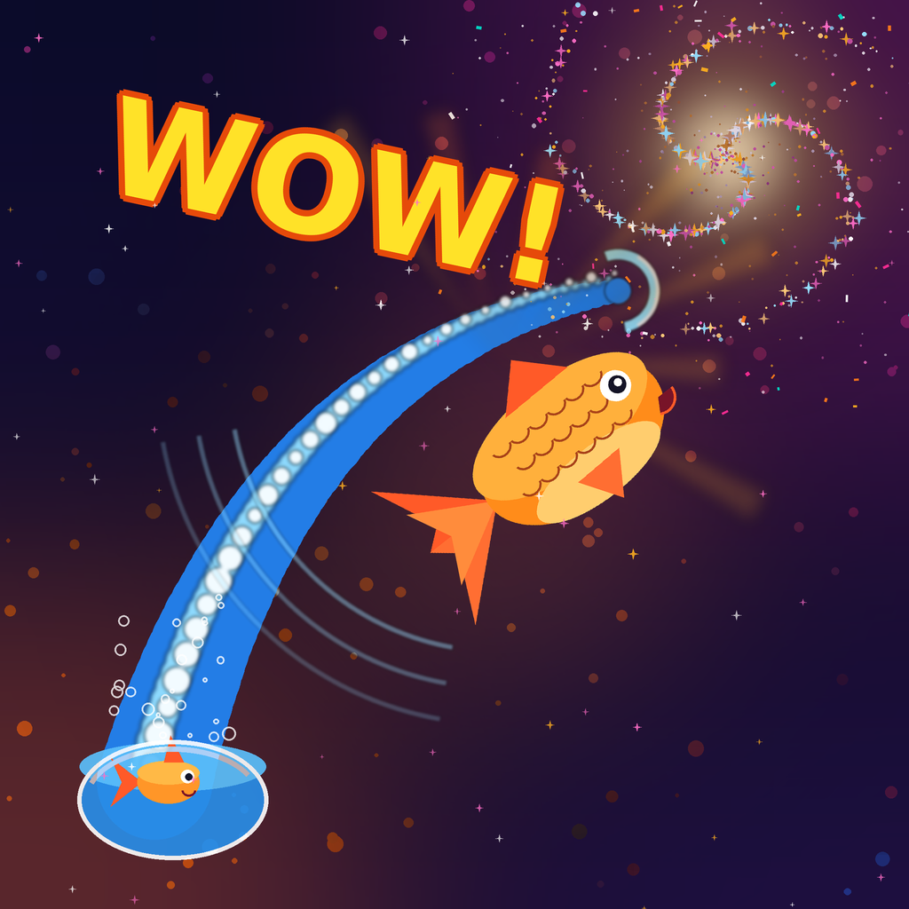

# One small leap becomes a universe

[](https://make.fun/c/ai-excited-01)
[](https://make.fun/c/ai-excited-01)
[](https://make.fun/c/ai-excited-01)

Entry for [make.fun's **ai-excited-01**](https://make.fun/c/ai-excited-01) — make the AI judge excited.



A tiny goldfish leaps out of its little glass bowl (bottom left); its splash
becomes a huge curling wave that spirals up into a galaxy of stars and
confetti (top right). One small leap becomes a universe — a scale twist, not
a stock explosion or firework. Saturated orange and magenta on deep indigo,
bold tilted yellow `WOW!`, and a second little fish still in the bowl,
cheering it on.

## How it is made

The image is drawn entirely in code by `draw_excited.py` (Pillow,
build-time only, deterministic seed `20261116`, 2x supersample with a
Lanczos downscale to 1024×1024). No external assets. The program,
`main.ts` (Node 22, standard library only), copies `entry.png` to
`/output/entry.png`, asserting the gate limits on the way (whole PNG,
≤ 1 MiB, ≤ 1024×1024).

```sh
python3 draw_excited.py          # redraw entry.png (deterministic)
mkdir -p out && MAKEFUN_OUTPUT_DIR=out node main.ts
```

## License

MIT — see [LICENSE](LICENSE).
